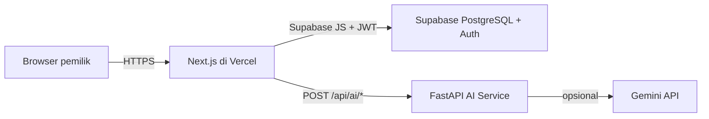

# Panduan Deployment Warcoffe 13

Dokumen ini ditujukan untuk **developer atau operator** yang akan menjalankan Warcoffe 13 Management System di production. Panduan mencakup deployment website ke Vercel, setup Supabase, deployment service AI, opsi hosting gratis, verifikasi, dan troubleshooting.

> **Untuk pemilik warung:** gunakan [Panduan Pengguna](./PANDUAN_PENGGUNA.md). Dokumen ini berisi istilah teknis.

---

## Daftar Isi

1. [Ringkasan Arsitektur](#1-ringkasan-arsitektur)
2. [Pilih Jalur Deployment](#2-pilih-jalur-deployment)
3. [Checklist Sebelum Deploy](#3-checklist-sebelum-deploy)
4. [Setup Supabase](#4-setup-supabase)
5. [Deploy Website ke Vercel](#5-deploy-website-ke-vercel)
6. [Deploy Service AI](#6-deploy-service-ai)
7. [Menghubungkan Vercel dan Service AI](#7-menghubungkan-vercel-dan-service-ai)
8. [Verifikasi End-to-End](#8-verifikasi-end-to-end)
9. [Troubleshooting](#9-troubleshooting)
10. [Rollback & Maintenance](#10-rollback--maintenance)
11. [Checklist Keamanan](#11-checklist-keamanan)
12. [Catatan Biaya & Kuota](#12-catatan-biaya--kuota)
13. [Referensi](#13-referensi)

---

## 1. Ringkasan Arsitektur



| Komponen | Wajib? | Host yang disarankan |
|---|---|---|
| Website Next.js | Ya | Vercel |
| Database + Auth | Ya | Supabase Cloud |
| Service AI FastAPI | Tidak | Hugging Face Spaces, Render, Railway, Cloud Run, atau Oracle Cloud |
| Gemini API | Tidak | Google AI Studio (opsional; tanpa key chat memakai fallback aturan) |

**Poin penting:** Vercel hanya menghosting aplikasi Next.js. Service AI Python/FastAPI **tidak bisa ikut dalam project Vercel yang sama**. Service AI harus di-host terpisah, atau fitur AI dinonaktifkan sementara.

---

## 2. Pilih Jalur Deployment

### Jalur A — Website saja (paling cepat)

Cocok untuk demo fitur inti: login, dashboard, POS, transaksi, menu, stok, pengeluaran, laporan, dan audit log.

- Deploy Next.js ke Vercel.
- Setup Supabase.
- Biarkan `AI_SERVICE_URL` kosong.
- Halaman AI akan menampilkan status service unavailable.

### Jalur B — Website + AI (lengkap)

Cocok untuk demo capstone penuh.

- Deploy Next.js ke Vercel.
- Setup Supabase.
- Deploy service AI ke host terpisah.
- Isi `AI_SERVICE_URL` di Vercel.
- Opsional: isi `GEMINI_API_KEY` untuk chat berbasis Gemini; tanpa key, chat memakai fallback deterministik.

---

## 3. Checklist Sebelum Deploy

- [ ] Branch production sudah berisi kode terbaru dan sudah di-push ke GitHub.
- [ ] `npm ci` berhasil.
- [ ] `npm run typecheck` berhasil.
- [ ] `npm test` berhasil.
- [ ] `npm run build` berhasil.
- [ ] `cd ai-service && pytest -q` berhasil (jika memakai AI).
- [ ] `.env.local` dan `ai-service/.env` **tidak** ikut ter-commit.
- [ ] Sudah punya akun Vercel, Supabase, dan (opsional) akun host AI.
- [ ] Sudah menyiapkan email/password owner untuk login.

> Hasil `npm audit` pada lockfile saat dokumen ini dibuat menunjukkan 1 critical dan 2 high pada `next`, `postcss`, dan `sharp`. Sebelum production, pertimbangkan upgrade patch Next.js 15.x dan jalankan ulang build/test.

---

## 4. Setup Supabase

### 4.1 Buat project

1. Buat project baru di [Supabase](https://supabase.com).
2. Pilih region **Southeast Asia (Singapore)** untuk pengguna Indonesia.
3. Simpan **Project URL** dan **anon/publishable key** dari **Project Settings → API**.

### 4.2 Jalankan schema dan seed

Buka **SQL Editor**, lalu jalankan berurutan:

1. Seluruh isi [`supabase/schema.sql`](../supabase/schema.sql).
2. Seluruh isi [`supabase/seed.sql`](../supabase/seed.sql).

Schema membuat 7 tabel:

- `menu_categories`
- `menu_items`
- `sales_transactions`
- `sales_transaction_items`
- `expenses`
- `stock_movements`
- `audit_logs`

Seed membuat 3 kategori dan 57 item menu awal. Tidak ada transaksi atau pengeluaran dummy.

Alternatif seed lewat CLI:

```bash
set -a
source .env.local
set +a
npm run seed
```

Script `npm run seed` membaca environment variables dari shell dan tidak otomatis memuat `.env.local`.

> Jalankan schema pada project baru. Jika dijalankan ulang pada project yang sudah punya policy dengan nama sama, `CREATE POLICY` bisa error “already exists”. Untuk rerun, hapus policy lama terlebih dahulu atau gunakan migration.

### 4.3 Buat akun owner

1. Buka **Authentication → Users → Add user**.
2. Isi email dan password pemilik.
3. Centang **Auto Confirm User**.
4. Simpan.

### 4.4 Set `app_metadata.role = 'owner'`

RLS di project ini hanya mengizinkan user dengan klaim JWT `app_metadata.role = 'owner'`. Jalankan SQL berikut di SQL Editor:

```sql
update auth.users
set raw_app_meta_data =
  coalesce(raw_app_meta_data, '{}'::jsonb)
  || jsonb_build_object('role', 'owner')
where email = 'owner@warcoffe13.id';
```

Ganti email sesuai akun pemilik. **Gunakan `app_metadata`, bukan `user_metadata`.**

Verifikasi:

```sql
select email, raw_app_meta_data
from auth.users
where email = 'owner@warcoffe13.id';
```

Setelah mengubah metadata, **logout lalu login ulang** agar JWT baru memuat role owner. Tanpa langkah ini, login bisa berhasil tetapi data tetap kosong karena RLS menolak akses.

### 4.5 Pengaturan Auth

Di **Authentication → URL Configuration**:

- **Site URL:** domain production, misalnya `https://warcoffe13.vercel.app` atau domain custom.
- **Redirect URLs:** tambahkan domain production dan domain preview yang dipakai.

Di **Authentication → Providers → Email**:

- Pastikan provider Email aktif.
- Nonaktifkan pendaftaran publik jika tidak diperlukan.

### 4.6 Verifikasi RLS

- Tabel bisnis harus memiliki RLS aktif.
- User owner harus bisa `select` dari `menu_categories` dan `menu_items`.
- User tanpa role owner harus ditolak.
- `audit_logs` hanya `SELECT` dan `INSERT` (append-only).

Jika login berhasil tetapi aplikasi menampilkan “Menggunakan penyimpanan lokal”, periksa role owner, schema, dan key Supabase.

---

## 5. Deploy Website ke Vercel

### 5.1 Import repository

1. Buka [Vercel](https://vercel.com) → **Add New Project**.
2. Import repository GitHub `klisarsana/warcoffe-13`.
3. Konfigurasi:
   - **Framework Preset:** Next.js
   - **Root Directory:** `.` (root repository)
   - **Build Command:** `npm run build`
   - **Install Command:** `npm install`

`vercel.json` sudah mengatur framework, build command, install command, dan region `sin1`.

### 5.2 Environment variables

Tambahkan untuk **Production** dan **Preview**:

| Variabel | Nilai | Catatan |
|---|---|---|
| `NEXT_PUBLIC_SUPABASE_URL` | `https://xxxx.supabase.co` | Wajib |
| `NEXT_PUBLIC_SUPABASE_ANON_KEY` | anon key | Pilih salah satu dengan publishable key |
| `NEXT_PUBLIC_SUPABASE_PUBLISHABLE_KEY` | `sb_publishable_...` | Format baru |
| `AI_SERVICE_URL` | URL service AI | Isi setelah AI online |
| `NEXT_PUBLIC_AI_SERVICE_URL` | URL service AI | Opsional, untuk label/status UI |

**Jangan tambahkan `SUPABASE_SERVICE_ROLE_KEY` ke Vercel.** Key itu hanya untuk `npm run seed` dari lokal.

Catatan:

- `NEXT_PUBLIC_*` dibaca saat build. Setelah mengubahnya, lakukan **Redeploy**.
- Cukup isi salah satu key Supabase. Jika keduanya diisi, kode memprioritaskan publishable key.
- Jangan pernah memakai service role key di variabel `NEXT_PUBLIC_*`.

### 5.3 Deploy

Klik **Deploy**. Setelah selesai:

1. Buka domain Vercel.
2. Login dengan akun owner.
3. Pastikan dashboard menampilkan data dan tidak ada peringatan penyimpanan lokal.
4. Update **Site URL** Supabase ke domain Vercel.

### 5.4 Custom domain

1. Buka **Vercel → Project → Settings → Domains**.
2. Tambahkan domain dan ikuti instruksi DNS.
3. Update **Site URL** dan **Redirect URLs** Supabase ke domain baru.

### 5.5 Batas waktu fungsi AI

Route proxy AI memakai timeout internal:

- `/api/ai/chat`: 12 detik.
- `/api/ai/parse-transaction`: 12 detik.
- `/api/ai/parse-transactions`: 15 detik.

Pastikan **Max Duration** fungsi Vercel lebih besar dari itu. Jika perlu, tambahkan di route:

```ts
export const maxDuration = 30;
```

Lalu redeploy. Tanpa konfigurasi ini, fungsi bisa dihentikan platform sebelum request ke service AI selesai.

---

## 6. Deploy Service AI

Service AI ada di folder [`ai-service/`](../ai-service/). Service ini memakai FastAPI, scikit-learn, dan model `.joblib` yang sudah ada di repository.

### 6.1 Pilihan hosting

| Host | Gratis permanen? | RAM | Tidur / cold start | Catatan |
|---|---:|---:|---|---|
| **Hugging Face Spaces (Docker, CPU Basic)** | Ya | 16 GB | Tidur setelah ±48 jam tidak aktif | Paling cocok untuk beban ML; Space publik; port 7860 |
| **Render Free Web Service** | Ya | 512 MB | Tidur setelah ±15 menit | Mudah; RAM ketat; cold start bisa 30–60 detik |
| **Koyeb Free** | Ya (cek kuota) | 512 MB | Scale-to-zero | Ringan; cocok untuk demo kecil |
| **Google Cloud Run** | Kuota gratis bulanan | 512 MB–1 GB | Scale-to-zero | Perlu billing account/kartu; lebih banyak setup |
| **Oracle Cloud Always Free** | Ya | Hingga 24 GB (ARM) | Tidak tidur | Perlu kartu verifikasi; setup paling berat; cocok untuk selalu aktif |
| **Railway** | Tidak permanen | Bervariasi | Bervariasi | Trial credit; setelah habis perlu bayar |
| **Vercel Python Functions** | Ya (Hobby) | Terbatas | Cold start | Perlu project terpisah dan adaptasi; risiko bundle/timeout; tidak disarankan |

> **Kombinasi full gratis untuk demo/capstone:** Vercel Hobby + Supabase Free + Hugging Face Spaces CPU Basic. `GEMINI_API_KEY` opsional; tanpa key, chat memakai fallback aturan. Free tier bisa tidur, jadi hangatkan service sebelum demo.

> Free tier sering berubah. Selalu cek ulang harga dan batas provider sebelum demo.

### 6.2 Rekomendasi gratis: Hugging Face Spaces

Hugging Face Spaces adalah pilihan paling praktis untuk service AI ini karena RAM besar dan mendukung Docker.

1. Buat akun di [Hugging Face](https://huggingface.co).
2. Buat **New Space** → pilih **Docker** → **CPU Basic** (free).
3. Buat Space publik. Jangan menyimpan secret di repository.
4. Tambahkan `Dockerfile` di folder `ai-service/` (atau di root Space):

```dockerfile
FROM python:3.13-slim

WORKDIR /app
ENV PYTHONDONTWRITEBYTECODE=1
ENV PYTHONUNBUFFERED=1

COPY requirements.txt .
RUN pip install --no-cache-dir -r requirements.txt

COPY . .

EXPOSE 7860
CMD ["uvicorn", "app.main:app", "--host", "0.0.0.0", "--port", "7860"]
```

> Sesuaikan tag Python dengan versi yang didukung dependency. Environment pengembangan saat ini memakai Python 3.15.2; jika image `3.13-slim` tidak cocok, gunakan versi lain yang tersedia dan pastikan `pip install` berhasil.
>
> `requirements.txt` saat ini juga memuat dependency testing/notebook (`pytest`, `ipykernel`, dll.). Untuk image produksi yang lebih kecil, pisahkan dependency runtime dan development.

5. Di **Space Settings → Variables and secrets**, tambahkan:

```text
GEMINI_API_KEY=<secret>
GEMINI_MODEL=gemini-3.5-flash-lite
GEMINI_FALLBACK_MODEL=gemini-3.8-flash
ALLOWED_ORIGINS=https://domain-vercel-kamu.vercel.app
TIMEZONE=Asia/Jakarta
```

6. Tunggu build selesai, lalu tes:

```bash
curl https://<nama-space>.hf.space/api/v1/health
```

7. Salin URL Space ke `AI_SERVICE_URL` di Vercel.

Catatan Hugging Face Spaces:

- Space publik berarti kode dan endpoint bisa dilihat orang. Gunakan **Secrets** untuk API key.
- Free tier tidur setelah sekitar 48 jam tidak aktif. Request pertama bisa lambat.
- Jangan taruh file `.env` berisi secret di repository.

### 6.3 Render Free Web Service

1. Buat **New Web Service** dari repository GitHub.
2. Set **Root Directory** ke `ai-service`.
3. Build command: `pip install -r requirements.txt`.
4. Start command: `uvicorn app.main:app --host 0.0.0.0 --port $PORT`.
5. Health check path: `/api/v1/health`.
6. Tambahkan environment variables yang sama seperti bagian 6.2.
7. Deploy dan tes health check.

Catatan:

- Render free memiliki RAM 512 MB. Service ini bisa berjalan, tetapi pantau OOM saat model dan dependency dimuat.
- Service tidur setelah ±15 menit tidak aktif. Request pertama bisa 30–60 detik.
- Hangatkan service sebelum demo dengan membuka health check.

### 6.4 Oracle Cloud Always Free (selalu aktif)

Cocok jika ingin service AI tidak tidur dan tidak keberatan dengan setup yang lebih teknis.

1. Buat akun Oracle Cloud (perlu verifikasi kartu).
2. Buat VM **Ampere A1** dengan konfigurasi Always Free.
3. Install Python, clone repository, buat virtual environment, dan install `requirements.txt`.
4. Jalankan service dengan systemd atau Docker di port internal.
5. Pasang reverse proxy (Nginx/Caddy) dengan HTTPS.
6. Arahkan `AI_SERVICE_URL` Vercel ke domain HTTPS tersebut.

Keunggulan: selalu aktif dan RAM besar. Kekurangan: setup, patching, dan monitoring menjadi tanggung jawab sendiri.

### 6.5 Google Cloud Run

1. Buat container image dari folder `ai-service/`.
2. Push ke Artifact Registry.
3. Deploy ke Cloud Run dengan port `$PORT` (biasanya 8080) dan memory minimal 512 MB–1 GB.
4. Set environment variables dan izinkan akses publik jika diperlukan.
5. Salin URL Cloud Run ke `AI_SERVICE_URL`.

Cloud Run memerlukan billing account, tetapi memiliki kuota gratis bulanan. Cold start bisa terjadi jika scale-to-zero.

### 6.6 Railway

Railway memiliki trial credit, bukan free tier permanen. Cocok untuk demo jangka pendek:

- Root directory: `ai-service`.
- Start command: `uvicorn app.main:app --host 0.0.0.0 --port $PORT`.
- Tambahkan environment variables.
- Setelah credit habis, service memerlukan pembayaran.

### 6.7 Vercel Python Functions (tidak disarankan)

Secara teknis Vercel mendukung Python serverless functions, tetapi `ai-service` ini bukan struktur serverless. Untuk memakainya perlu project Vercel terpisah, adapter `api/index.py`, konfigurasi rewrite, dan pengurangan dependency. Risikonya:

- Bundle dependency scikit-learn/numpy/pandas bisa besar.
- Cold start dan batas durasi fungsi.
- Tidak ada filesystem persisten.
- Perlu penyesuaian struktur project.

Untuk project ini, host Python khusus (Hugging Face Spaces/Render/Oracle) lebih aman.

---

## 7. Menghubungkan Vercel dan Service AI

Setelah service AI online:

1. Tes health check:

```bash
curl https://domain-service-ai/api/v1/health
```

Response sehat berisi `status: "ok"` dan `model_loaded: true`.

2. Di Vercel, set:

```text
AI_SERVICE_URL=https://domain-service-ai
NEXT_PUBLIC_AI_SERVICE_URL=https://domain-service-ai
```

3. Redeploy Vercel.
4. Buka `/ai-assistant` dan tes:
   - chat bisnis,
   - input satu kalimat transaksi,
   - input beberapa tanggal,
   - simpan draft.

Jika `AI_SERVICE_URL` kosong, fitur inti tetap berjalan; halaman AI akan menampilkan status service unavailable.

---

## 8. Verifikasi End-to-End

### Website

- [ ] Halaman login terbuka tanpa peringatan konfigurasi.
- [ ] Login owner berhasil.
- [ ] Dashboard menampilkan data dan tidak ada peringatan penyimpanan lokal.
- [ ] Buat transaksi POS, refresh, lalu cek data masih ada.
- [ ] Buka dari browser/perangkat lain; data harus sama (mode Supabase).
- [ ] Tambah/edit/hapus menu.
- [ ] Isi stok awal, stok masuk, stok keluar, dan opname.
- [ ] Tambah/edit/hapus pengeluaran.
- [ ] Buka laporan bulanan dan ekspor CSV.
- [ ] Buka audit log dan cek aktivitas tercatat.
- [ ] Logout dan pastikan route terproteksi tidak bisa diakses.

### Service AI

- [ ] `GET /api/v1/health` mengembalikan `status: "ok"`.
- [ ] `POST /api/v1/parse-transactions` mengembalikan draft.
- [ ] `POST /api/v1/chat` menjawab pertanyaan.
- [ ] Draft AI bisa disimpan dan muncul di riwayat transaksi.
- [ ] Jika Gemini gagal, fallback tetap menjawab.

### Keamanan

- [ ] User tanpa role owner tidak bisa membaca data.
- [ ] `SUPABASE_SERVICE_ROLE_KEY` tidak ada di Vercel.
- [ ] Service role key tidak ada di bundle browser.
- [ ] Preview deployment tidak memakai database production (jika publik).
- [ ] Route AI tidak bisa dipanggil tanpa batas (tambahkan rate limit/token jika production).

---

## 9. Troubleshooting

| Gejala | Penyebab | Solusi |
|---|---|---|
| Halaman login: “Supabase belum dikonfigurasi” | Env kosong atau build lama | Isi env, restart dev; di Vercel redeploy |
| Login sukses, data kosong | `app_metadata.role` belum owner | Jalankan SQL role owner, logout/login ulang |
| “Menggunakan penyimpanan lokal” | Query Supabase gagal/RLS menolak | Cek schema, role owner, key, dan console browser |
| “Supabase belum di-migrasi” | Tabel belum dibuat | Jalankan `supabase/schema.sql` |
| `npm run seed` gagal | Service role key kosong atau env belum diekspor ke shell | Isi `.env.local`, jalankan `set -a; source .env.local; set +a`, lalu `npm run seed`; alternatifnya jalankan `seed.sql` |
| Policy already exists | Schema dijalankan ulang | Hapus policy lama atau gunakan migration |
| AI 503 | `AI_SERVICE_URL` kosong/salah atau service mati | Deploy AI, isi URL, redeploy Vercel |
| AI timeout | Cold start atau service lambat | Hangatkan service, naikkan timeout/maxDuration, gunakan plan selalu aktif |
| AI health `degraded` | Model `.joblib` tidak ditemukan | Pastikan folder `models/` ikut ter-deploy dan path benar |
| Data berbeda antar perangkat | Local fallback | Perbaiki Supabase/RLS |
| CSV kosong | Bulan tanpa data | Pilih bulan lain |
| Build Vercel tidak melihat env | Env ditambahkan setelah build | Redeploy |

---

## 10. Rollback & Maintenance

### Rollback

- **Vercel:** buka **Deployments**, pilih deployment sebelumnya, lalu **Promote to Production**.
- **Supabase:** gunakan backup/PITR sesuai plan; untuk data kecil, ekspor CSV dari halaman laporan.
- **Service AI:** redeploy commit/image sebelumnya dari host yang dipakai.

### Maintenance rutin

- Periksa log Vercel dan log service AI.
- Pantau kuota Gemini dan biaya host.
- Perbarui dependency secara berkala; jalankan typecheck, test, dan build.
- Rotasi `GEMINI_API_KEY` dan service role key jika pernah bocor.
- Backup data Supabase dan ekspor CSV bulanan.
- Cek masa aktif project Supabase free tier (bisa pause setelah lama tidak aktif).

---

## 11. Checklist Keamanan

- [ ] RLS aktif di semua tabel bisnis.
- [ ] Hanya user dengan `app_metadata.role = 'owner'` yang bisa mengakses data.
- [ ] Pendaftaran publik dinonaktifkan.
- [ ] `SUPABASE_SERVICE_ROLE_KEY` hanya ada di lingkungan lokal/CLI.
- [ ] Tidak ada secret di `NEXT_PUBLIC_*`.
- [ ] `GEMINI_API_KEY` hanya ada di service AI.
- [ ] Service AI tidak diekspos tanpa proteksi jika dipakai untuk production.
- [ ] Route `/api/ai/*` diberi autentikasi/rate limit.
- [ ] Preview deployment tidak memakai database production.
- [ ] HTTPS aktif.
- [ ] Backup data tersedia.

---

## 12. Catatan Biaya & Kuota

- **Vercel Hobby:** gratis untuk project personal/demo, dengan batas bandwidth dan durasi fungsi.
- **Supabase Free:** gratis dengan batas database, auth, dan bandwidth; project bisa pause setelah tidak aktif.
- **Hugging Face Spaces CPU Basic:** gratis, RAM besar, tidur setelah ±48 jam tidak aktif.
- **Render Free:** gratis, RAM 512 MB, tidur setelah ±15 menit.
- **Oracle Cloud Always Free:** gratis dalam batas resource, tetapi perlu kartu verifikasi dan setup manual.
- **Cloud Run:** kuota gratis bulanan, tetapi perlu billing account.
- **Gemini API:** ada free tier dengan rate limit; service tetap bisa berjalan tanpa key memakai fallback aturan.

---

## 13. Referensi

- [README utama](../README.md)
- [Panduan Pengguna](./PANDUAN_PENGGUNA.md)
- [Service AI](../ai-service/README.md)
- [Model Artifacts](../ai-service/models/README.md)
- [Schema Supabase](../supabase/schema.sql)
- [Seed Menu](../supabase/seed.sql)
- [Vercel Documentation](https://vercel.com/docs)
- [Supabase Documentation](https://supabase.com/docs)
- [Hugging Face Spaces Documentation](https://huggingface.co/docs/hub/spaces)
- [Render Documentation](https://render.com/docs)

---

*Terakhir diperbarui: 26 November 2026.*
